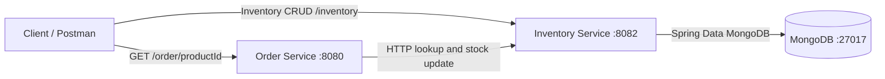
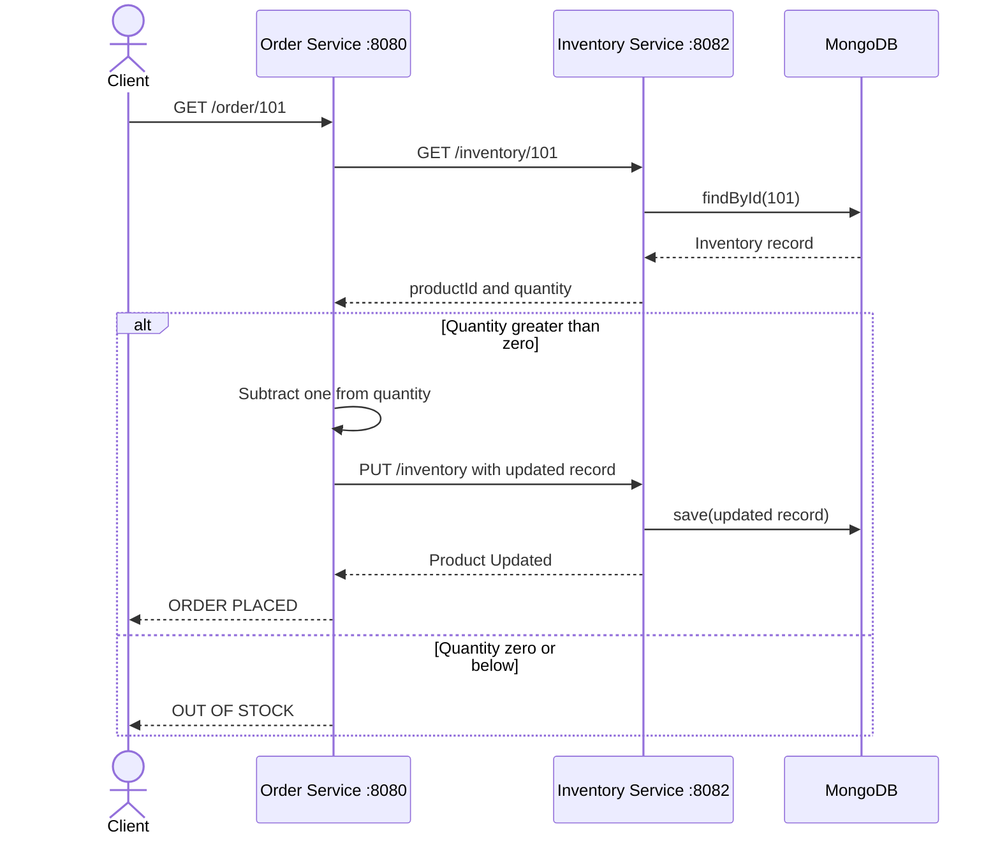

# E-commerce Microservices — Learning Project

Learning microservices by building a small e-commerce backend with **Java, Spring Boot, and MongoDB**. The project currently contains an Inventory Service and an Order Service that communicate over HTTP.

> **Work in progress:** this repository documents the implementation so far, including unfinished behavior and known issues. The order-to-inventory lookup currently needs a URL correction before the happy path can work.

## What I am learning

- Splitting a backend into services with separate responsibilities.
- Building REST endpoints with controllers and service classes.
- Persisting inventory through Spring Data MongoDB repositories.
- Calling another service with Spring's `RestClient`.
- Mapping JSON responses into a DTO.
- Handling downstream HTTP errors with a custom exception and `@RestControllerAdvice`.
- Understanding why stock updates need extra care when requests run concurrently.

## Services at a glance

| Service | Port | Responsibility | Storage |
| --- | --- | --- | --- |
| `ecom-inventory-service` | `8082` | Add, look up, update, and delete product stock | MongoDB |
| `ecom-order-service` | `8080` | Check stock and request a one-unit stock reduction | No order database yet |

Each service is a separate Spring Boot application with its own Maven build. There is no shared parent build or API gateway in the current source.

## Architecture



Inventory owns stock data. Order receives an inventory DTO over HTTP and asks Inventory to save the changed quantity; it does not connect directly to MongoDB.

### Intended order flow

The sequence below describes the happy path **after correcting the lookup URL** in `OrderService.java` from `/inventory55/{productId}` to `/inventory/{productId}`.



`ORDER PLACED` currently means the inventory update completed. The application does not yet create an order record, order ID, payment, or shipment.

### Current error-handling flow

The lookup currently requests `/inventory55/{productId}`, which has no matching controller route. A downstream `4xx` response triggers `MyCustomException`; `GlobalExceptionHandler` returns the same HTTP status with the body `Inventory request failed`.

That custom mapping applies to the inventory lookup's `4xx` responses. Connection failures, downstream `5xx` responses, and failures during the stock update do not have equivalent custom handling yet.

## Technology used

| Component | Current source configuration |
| --- | --- |
| Java | `21` |
| Spring Boot | `4.2.0` in both POM files |
| Web | Spring MVC |
| HTTP client | `RestClient` for active service calls |
| Persistence | Spring Data MongoDB in Inventory |
| Boilerplate reduction | Lombok in Inventory |
| Build | Maven Wrapper in each service |
| Tests | A generated Spring Boot context-load test per service |

A `RestTemplate` bean is also configured and injected into Order, but the current request flow uses `RestClient`.

## Project structure

The current local workspace uses two sibling directories:

```text
microservices/
|-- ecom-inventory-service/
|   |-- README.md
|   |-- pom.xml
|   |-- mvnw / mvnw.cmd
|   `-- src/
|       |-- main/java/com/microservices/ecominventoryservice/
|       |   |-- controller/InventoryController.java
|       |   |-- service/InventoryService.java
|       |   |-- Repository/InventoryRepository.java
|       |   `-- model/Inventory.java
|       |-- main/resources/application.properties
|       `-- test/java/...
`-- ecom-order-service/
    |-- README.md
    |-- pom.xml
    |-- mvnw / mvnw.cmd
    `-- src/
        |-- main/java/com/microservices/ecomorderservice/
        |   |-- config/Config.java
        |   |-- controller/OrderController.java
        |   |-- services/OrderService.java
        |   |-- dto/Inventory.java
        |   `-- exception/
        |       |-- MyCustomException.java
        |       `-- GlobalExceptionHandler.java
        |-- main/resources/application.properties
        `-- test/java/...
```

Within Inventory, requests follow **Controller → Service → Repository → MongoDB**. Within Order, requests follow **Controller → Service → RestClient → Inventory Service**.

## Run locally

### 1. Prerequisites

- JDK 21, with `JAVA_HOME` set and Java available on `PATH`.
- A running local MongoDB instance on port `27017`.
- Both service directories for the complete flow.
- Network access on the first Maven Wrapper run to download Maven and dependencies.

### 2. Review configuration

Inventory currently contains:

```properties
spring.application.name=ecom-inventory-service
server.port=8082
spring.data.mongodb.uri=mongodb://localhost:27017/microservices/inventory
```

Order currently contains:

```properties
spring.application.name=ecom-order-service
server.port=8080
```

**MongoDB configuration needs verification:** the checked-in URI has two path segments, `microservices/inventory`. Confirm the intended database and the MongoDB property supported by the configured Spring Boot version before treating this as a working connection. A collection is selected through MongoDB mapping, rather than appended as a second database path segment. `InventoryRepository` supplies the persistence operations for the `Inventory` model.

### 3. Start Inventory

Open a terminal in `ecom-inventory-service`:

```powershell
.\mvnw.cmd spring-boot:run
```

### 4. Start Order

Open another terminal in `ecom-order-service`:

```powershell
.\mvnw.cmd spring-boot:run
```

On macOS/Linux, use `./mvnw spring-boot:run` in each directory. Correct the lookup path described above before testing a successful order.

## API reference

| Service | Method | Path | Request body | Current result |
| --- | --- | --- | --- | --- |
| Inventory | `POST` | `/inventory` | Inventory JSON | `Product Added` |
| Inventory | `GET` | `/inventory/{productId}` | None | Inventory JSON when found |
| Inventory | `PUT` | `/inventory` | Inventory JSON | `Product Updated` |
| Inventory | `DELETE` | `/inventory/{productId}` | None | `Product Deleted` |
| Order | `GET` | `/order/{productId}` | None | Intended: `ORDER PLACED` or `OUT OF STOCK`; currently the lookup hits an incorrect route |

Inventory JSON:

```json
{
  "productId": 101,
  "quantity": 5
}
```

`POST` and `PUT` both call `repository.save(...)`: they currently share save/upsert behavior and do not enforce separate create-only or update-only rules. These controllers use default success statuses; explicit creation responses have not been added.

### Try the flow with PowerShell

After confirming MongoDB configuration and starting Inventory:

```powershell
# Create stock for product 101.
Invoke-RestMethod -Method Post -Uri 'http://localhost:8082/inventory' -ContentType 'application/json' -Body '{"productId":101,"quantity":5}'

# Read the inventory record.
Invoke-RestMethod -Method Get -Uri 'http://localhost:8082/inventory/101'
```

After correcting the Order lookup URL and starting Order:

```powershell
# Order one unit. Expected text: ORDER PLACED.
Invoke-RestMethod -Method Get -Uri 'http://localhost:8080/order/101'

# Expected quantity after one successful order: 4.
Invoke-RestMethod -Method Get -Uri 'http://localhost:8082/inventory/101'

# Set stock to zero and try again. Expected text: OUT OF STOCK.
Invoke-RestMethod -Method Put -Uri 'http://localhost:8082/inventory' -ContentType 'application/json' -Body '{"productId":101,"quantity":0}'
Invoke-RestMethod -Method Get -Uri 'http://localhost:8080/order/101'

# Remove the example record.
Invoke-RestMethod -Method Delete -Uri 'http://localhost:8082/inventory/101'
```

These are manual verification steps and expected outcomes, not a report of a completed end-to-end test.

## Current progress and next steps

### Implemented in source

- [x] Two independently configured Spring Boot services.
- [x] Inventory CRUD endpoints and a MongoDB repository.
- [x] Inventory model and a separate Order-side inventory DTO.
- [x] HTTP lookup and update calls using `RestClient`.
- [x] Logic to reduce available stock by one.
- [x] A custom handler for inventory lookup `4xx` responses.

### Next learning milestones

- [ ] Correct `/inventory55/{productId}` and verify MongoDB configuration.
- [ ] Return a clear `404` for a missing product; `Optional.get()` currently throws when it is absent.
- [ ] Validate product IDs and quantities, including negative stock.
- [ ] Use `POST` for order creation; the current `GET` endpoint changes stock.
- [ ] Add order persistence, an order ID, and an order request/response model.
- [ ] Make stock decrement atomic within Inventory. The current separate read and write can lose updates when orders arrive together.
- [ ] Configure the Inventory base URL outside Java code.
- [ ] Add HTTP timeouts and consistent downstream failure handling. Define idempotency before retrying stock-changing requests.
- [ ] Add focused tests for available stock, zero stock, missing products, and downstream failures.
- [ ] Explore Docker Compose, an API gateway, service discovery, and observability as later steps.

## Tests and verification

Run from each service directory:

```powershell
.\mvnw.cmd test
```

The current tests only load each application context; they do not verify endpoint behavior or communication between services. Inventory context startup may require valid MongoDB configuration.

This README was checked against the source. Build and runtime behavior were not verified during documentation preparation because Java was unavailable on the terminal's `PATH` and `JAVA_HOME` was unset.

## GitHub preparation

Both services already include `.gitignore` rules for Maven `target/` output and IDE files. Keep source, POM files, Maven Wrapper scripts, and `.mvn/wrapper/maven-wrapper.properties` when publishing. Keep credentials and local secrets out of Git.

Repository: [Santhosh6466/microservices](https://github.com/Santhosh6466/microservices). Both services are included in separate folders.
