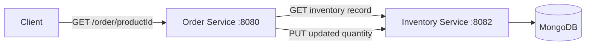

# E-commerce Order Service

A Spring Boot service built while learning microservices. It calls the companion Inventory Service over HTTP, checks stock, and requests a one-unit quantity reduction.

> **Work in progress:** the current lookup URL uses `/inventory55/{productId}`. Inventory exposes `/inventory/{productId}`, so this path must be corrected before successful order placement can be tested.

## Service flow



For an available product, `OrderService` subtracts one from the received quantity, sends the updated record to Inventory, and returns `ORDER PLACED`. For a null response body or a quantity of zero or below, it returns `OUT OF STOCK`. No order record is saved yet.

## Run locally

1. Install JDK 21 and configure `JAVA_HOME` and `PATH`.
2. Configure and start MongoDB and the companion `ecom-inventory-service` on port `8082`.
3. Correct the lookup path in `src/main/java/com/microservices/ecomorderservice/services/OrderService.java`.
4. Open a terminal in this service directory and run:

```powershell
.\mvnw.cmd spring-boot:run
```

On macOS/Linux, use `./mvnw spring-boot:run`. Maven and dependencies may be downloaded on the first run. The POM currently declares Java 21 and Spring Boot `4.2.0`.

## Endpoint

| Method | URL | Intended response |
| --- | --- | --- |
| `GET` | `http://localhost:8080/order/{productId}` | `ORDER PLACED` or `OUT OF STOCK` |

First create an inventory record in the companion service:

```powershell
Invoke-RestMethod -Method Post -Uri 'http://localhost:8082/inventory' -ContentType 'application/json' -Body '{"productId":101,"quantity":5}'
Invoke-RestMethod -Method Get -Uri 'http://localhost:8080/order/101'
Invoke-RestMethod -Method Get -Uri 'http://localhost:8082/inventory/101'
```

After fixing the lookup path, a successful order should reduce quantity from `5` to `4`. These are expected results, not a completed runtime verification.

## Code guide

| Location | Purpose |
| --- | --- |
| `controller/OrderController.java` | Exposes `/order/{productId}` |
| `services/OrderService.java` | Looks up inventory and requests the stock update |
| `dto/Inventory.java` | Receives product ID and quantity from Inventory |
| `config/Config.java` | Creates HTTP client beans; active calls use `RestClient` |
| `exception/MyCustomException.java` | Carries a downstream HTTP status |
| `exception/GlobalExceptionHandler.java` | Maps the custom exception to `Inventory request failed` |
| `src/main/resources/application.properties` | Sets service name and port `8080` |

Lookup `4xx` responses use the custom exception handler and preserve the downstream status. Connection failures, `5xx` responses, and stock update failures do not yet have equivalent custom handling.

## Next steps

- Correct the Inventory lookup URL and externalize the base URL.
- Move order creation to `POST`, since it changes state.
- Persist orders and return an order ID.
- Move stock decrement into an atomic operation owned by Inventory.
- Add request validation, HTTP timeouts, and focused behavior tests.

Run the existing context-load test with `.\mvnw.cmd test`. It does not cover the order flow. Builds and runtime behavior were not verified during documentation preparation because Java was unavailable on `PATH` and `JAVA_HOME` was unset.

The companion Inventory Service's README contains the full project overview, sequence diagram, inventory API reference, configuration notes, and learning roadmap. The current workspace stores both services in sibling directories; the GitHub layout is still pending.
